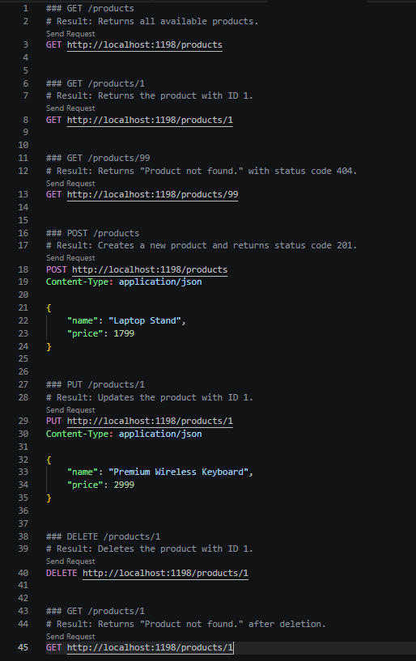

# CRUD API

A focused backend project demonstrating CRUD operations using Node.js and Express.



## Tech Stack

- Node.js
- Express.js

## Getting Started

Install dependencies:

```bash
npm install
```

Create a `.env` file using `.env.example`:

```env
PORT=1198
```

Start the development server:

```bash
npm run dev
```

## Development

Development Port: **1198**

Base URL: `http://localhost:1198`

Product names are limited to 120 characters. Prices must be finite, non-negative numbers. Product IDs must be positive integers. Records live in server memory and reset when the process restarts; this example does not use a database.

## API Endpoints

| Method | Endpoint        | Description                |
| ------ | --------------- | -------------------------- |
| GET    | `/products`     | Fetch all products         |
| GET    | `/products/:id` | Fetch a single product     |
| POST   | `/products`     | Create a new product       |
| PUT    | `/products/:id` | Update an existing product |
| DELETE | `/products/:id` | Delete an existing product |
| GET    | `/health`        | Check API health |

## API Testing

Use the included `requests.http` file to test all API endpoints directly from VS Code with the REST Client extension.

## License

MIT

## Support

If you find this project helpful, consider supporting my work:

❤️ [Support My Work](https://a2rp-donation-page.netlify.app/)

## Connect with Me

- 🌐 Portfolio: <https://www.ashishranjan.net>
- 💻 GitHub: <https://github.com/a2rp>
- ✒️ CodePen: <https://codepen.io/ash1198>
- 💼 LinkedIn: <https://www.linkedin.com/in/aashishranjan>
- 📘 Facebook: <https://www.facebook.com/theash.ashish/>
- ▶️ YouTube: <https://www.youtube.com/@ashishranjan-ashz>

## Links

- Portfolio: [https://www.ashishranjan.net](https://www.ashishranjan.net)
- GitHub: [https://github.com/a2rp](https://github.com/a2rp)
- CodePen: [https://codepen.io/ash1198](https://codepen.io/ash1198)
- LinkedIn: [https://www.linkedin.com/in/aashishranjan](https://www.linkedin.com/in/aashishranjan)
- Facebook: [https://www.facebook.com/theash.ashish/](https://www.facebook.com/theash.ashish/)
- YouTube: [https://www.youtube.com/@ashishranjan-ashz?sub_confirmation=1](https://www.youtube.com/@ashishranjan-ashz?sub_confirmation=1)
- Email: [ash.ranjan09@gmail.com](mailto:ash.ranjan09@gmail.com)

## Support

- Support: [https://a2rp-donation-page.netlify.app/](https://a2rp-donation-page.netlify.app/)
- Buy Me A Coffee: [https://buymeacoffee.com/a2rp](https://buymeacoffee.com/a2rp)
- Patreon: [https://patreon.com/a2rp](https://patreon.com/a2rp)
