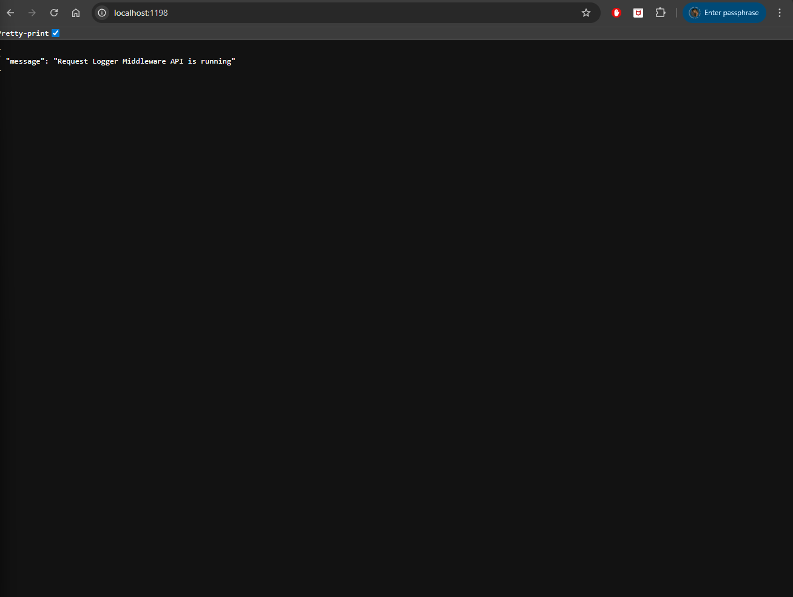

# express-project-05-request-logger-middleware

A simple Express.js backend project demonstrating how to build and use a custom request logging middleware.

## Project Goal

This project focuses on understanding how middleware works in Express.js and how to log every incoming HTTP request.

The middleware captures:

- request time
- HTTP method
- request path (query values are excluded)

## Tech Stack

- Node.js
- Express.js
- Nodemon (development)

## Project Structure

```
express-project-05-request-logger-middleware
│
├── src/
│   ├── controllers/
│   │   └── home.controller.js
│   ├── middleware/
│   │   └── requestLogger.middleware.js
│   └── routes/
│       └── home.routes.js
├── .gitignore
├── image.png
├── index.js
├── package-lock.json
├── package.json
└── README.md
```

## Installation

Clone the repository

```bash
git clone https://github.com/a2rp/express-project-05-request-logger-middleware.git
cd express-project-05-request-logger-middleware
```

Install dependencies

```bash
npm install
```

## Run the Project

Development mode using nodemon

```bash
npm run dev
```

Server will run at

```
http://localhost:1198
```

## API Endpoint

### GET /

Returns a simple JSON response.

Example response

```json
{
    "message": "Request Logger Middleware API is running"
}
```

---



---

## Middleware Example Output

Every request will be logged in the console.

Example log

```
[2026-03-17T10:10:10.345Z] GET /
```

The log contains the timestamp, HTTP method, and path. The query string is left out so values passed as URL parameters are not copied into this log.

This shows:

- request timestamp
- HTTP method
- request path (query string excluded)

## Learning Outcome

By building this project you learn:

- how Express middleware works
- how to intercept incoming requests
- how to log request information
- how middleware fits into the request lifecycle

## Author

Ashish Ranjan

---

Follow me

- GitHub: https://github.com/a2rp
- Portfolio: https://www.ashishranjan.net
- LinkedIn: https://www.linkedin.com/in/aashishranjan
- Facebook: https://www.facebook.com/theash.ashish/
